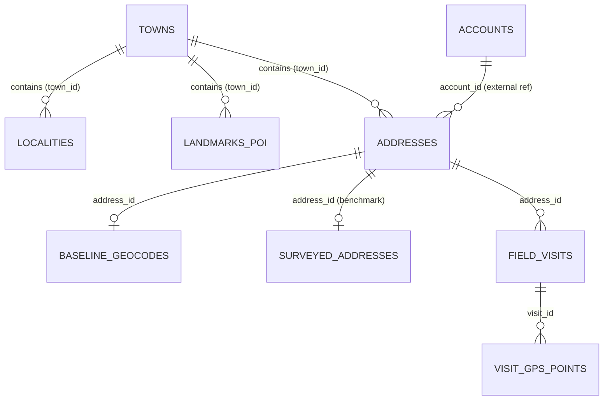

# PS3 Data Contract & Schema Specification
*Document 2 of 5: Source Data Contracts, Empirical Audit & Schemas*
*Status: FROZEN (Data Contract Level)*

---

## 1. Source Table Specifications & Relational Graph

The system ingests 8 primary CSV tables. All spatial coordinates are **metric Cartesian coordinates in meters** centered at $(0, 0)$ for each town:

> **External Reference Tables Note**: `accounts.csv` and `agents.csv` are external/shared reference tables across the broader competition directory (used for multi-problem borrower metadata and agent roster lookups) and are not part of the 8 core PS3 geocoder datasets. The 8 primary geocoder tables specified below constitute the complete self-contained spatial and operational domain for NeuroGeo-Field.



### Table 1: `data/shared/addresses.csv`
Master table of all addresses recorded during loan origination or KYC updates.
- **Rows**: 3,117
- **Primary Key**: `address_id`
- **Foreign Keys**: `account_id` $\to$ `accounts.csv`, `town_id` $\to$ `towns.csv` (or `'OUT'`)

| Column | Type | Null % | Unique % | Description / Constraints | Example |
| :--- | :--- | :---: | :---: | :--- | :--- |
| `address_id` | `str` | 0.0% | 100.0% | Unique identifier (`AD\d{6}`) | `AD000001` |
| `account_id` | `str` | 0.0% | 77.0% | Associated borrower loan account (`AC\d{6}`) | `AC000001` |
| `address_type` | `str` | 0.0% | 0.1% | Enum: `residence`, `office`, `permanent_native` | `residence` |
| `source` | `str` | 0.0% | 0.1% | Enum: `kyc_origination`, `skip_trace` | `kyc_origination` |
| `added_date` | `str` | 0.0% | 0.8% | ISO-8601 date string (`YYYY-MM-DD`) | `2026-04-01` |
| `town_id` | `str` | 0.0% | 0.1% | Enum: `T1`, `T2`, `T3`, or `OUT` (Out of territory) | `T1` |
| `address_text` | `str` | 0.0% | 99.9% | Unstructured, multilingual address description | *"6th Cross, 5th Main, Kuvempu Layt"* |

### Table 2: `data/ps3_geocoder/baseline_geocodes.csv`
Output from a commercial geocoding engine (e.g., Google Maps / MapmyIndia) for all in-territory addresses.
- **Rows**: 2,880 (Matches exactly $3,117 - 237\text{ [town_id == 'OUT']}$)
- **Primary Key**: `address_id`
- **Foreign Key**: `address_id` $\to$ `addresses.csv`

| Column | Type | Null % | Unique % | Description / Constraints | Example |
| :--- | :--- | :---: | :---: | :--- | :--- |
| `address_id` | `str` | 0.0% | 100.0% | Foreign key to `addresses.csv` | `AD000001` |
| `geocoder_x` | `float64`| 0.0% | 97.4% | Metric X coordinate in meters | `1255.5` |
| `geocoder_y` | `float64`| 0.0% | 97.7% | Metric Y coordinate in meters | `-276.5` |
| `precision` | `str` | 0.0% | 0.1% | Enum: `rooftop`, `street`, `locality`, `pincode` | `locality` |

### Table 3: `data/shared/field_visits.csv`
Operational check-in events logged by field collection agents on mobile apps.
- **Rows**: 5,578
- **Primary Key**: `visit_id`
- **Foreign Keys**: `address_id` $\to$ `addresses.csv`, `agent_id` $\to$ `agents.csv`

| Column | Type | Null % | Unique % | Description / Constraints | Example |
| :--- | :--- | :---: | :---: | :--- | :--- |
| `visit_id` | `str` | 0.0% | 100.0% | Unique visit identifier (`VS\d{6}`) | `VS000001` |
| `account_id` | `str` | 0.0% | 24.0% | Loan account visited | `AC000652` |
| `address_id` | `str` | 0.0% | 26.5% | Target address visited (1,477 unique addresses) | `AD000840` |
| `agent_id` | `str` | 0.0% | 0.2% | Field agent identifier (`FA001` to `FA009`) | `FA003` |
| `visit_date` | `str` | 0.0% | 1.4% | ISO-8601 date string (`YYYY-MM-DD`) | `2026-04-01` |
| `start_ts` | `str` | 0.0% | 99.7% | Trip start timestamp (`YYYY-MM-DD HH:MM:SS`) | `2026-04-01 10:21:26` |
| `checkin_ts` | `str` | 0.0% | 99.8% | Check-in button click timestamp | `2026-04-01 11:00:13` |
| `checkin_x` | `float64`| 0.0% | 94.4% | Mobile device GPS X coordinate at check-in (m) | `1409.8` |
| `checkin_y` | `float64`| 0.0% | 94.2% | Mobile device GPS Y coordinate at check-in (m) | `-1495.1` |
| `gps_accuracy_m`| `float64`| 0.0%| 5.8% | Device horizontal accuracy radius (m) | `11.7` |
| `dwell_s` | `int64` | 0.0% | 20.2% | Stationary duration at check-in location (seconds)| `65` |
| `outcome` | `str` | 0.0% | 0.1% | 7 outcome categories (see Section 3) | `address_not_traceable` |
| `ptp_id` | `str` | 89.2% | 10.8% | Promise to pay ID if captured on visit | `PTP000042` |
| `remark` | `str` | 0.0% | 13.7% | Free-text operational remark logged by agent | *"nija mane Milk Dairy hinde"* |
| `photo_hash` | `str` | 0.0% | 97.1% | MD5/Perceptual hash of proof photo | `cc10046a2da9` |

### Table 4: `data/ps3_geocoder/visit_gps_points.csv`
Granular GPS breadcrumbs logged every 30 seconds during each field visit.
- **Rows**: 160,406 (Exactly 5,578 visits represented, 100.0% coverage)
- **Primary Key**: (`visit_id`, `seq`)
- **Foreign Key**: `visit_id` $\to$ `field_visits.csv`

| Column | Type | Null % | Unique % | Description / Constraints | Example |
| :--- | :--- | :---: | :---: | :--- | :--- |
| `visit_id` | `str` | 0.0% | 3.5% | Foreign key to `field_visits.csv` | `VS005575` |
| `seq` | `int64` | 0.0% | 0.1% | Sequential point index ($0, 1, \dots, N_v-1$) | `0` |
| `point_ts` | `str` | 0.0% | 92.4% | Point capture timestamp | `2026-06-29 10:50:49` |
| `x` | `float64`| 0.0% | 3.5% | Intermediate trajectory X coordinate (m) | `2147.0` |
| `y` | `float64`| 0.0% | 3.6% | Intermediate trajectory Y coordinate (m) | `-750.0` |
| `accuracy_m` | `float64`| 0.0% | 0.1% | Instantaneous GPS accuracy radius (m) | `15.0` |

### Table 5: `data/ps3_geocoder/landmarks_poi.csv`
Point-of-Interest gazetteer across the three operational towns.
- **Rows**: 240 (T1: 82, T2: 77, T3: 81)
- **Primary Key**: `poi_id`
- **Foreign Key**: `town_id` $\to$ `towns.csv`

| Column | Type | Null % | Unique % | Description / Constraints | Example |
| :--- | :--- | :---: | :---: | :--- | :--- |
| `poi_id` | `str` | 0.0% | 100.0% | Unique landmark identifier (`LM\d{4}`) | `LM0001` |
| `town_id` | `str` | 0.0% | 1.2% | Town identifier (`T1`, `T2`, `T3`) | `T1` |
| `landmark_type`| `str` | 0.0% | 5.8% | 14 categories (see Section 2) | `community_hall` |
| `name` | `str` | 0.0% | 5.8% | Standardized English label | `Community Hall` |
| `x` | `float64`| 0.0% | 99.2% | Approximate X coordinate (m) | `-3083.2` |
| `y` | `float64`| 0.0% | 99.6% | Approximate Y coordinate (m) | `1414.7` |

### Table 6: `data/ps3_geocoder/localities.csv`
Neighborhood administrative boundaries and reference centroids.
- **Rows**: 36 (Exactly 12 localities per town)
- **Primary Key**: `locality_id`
- **Foreign Key**: `town_id` $\to$ `towns.csv`

| Column | Type | Null % | Unique % | Description / Constraints | Example |
| :--- | :--- | :---: | :---: | :--- | :--- |
| `locality_id` | `str` | 0.0% | 100.0% | Locality code (`T\d-L\d{2}`) | `T1-L01` |
| `town_id` | `str` | 0.0% | 8.3% | Town code (`T1`, `T2`, `T3`) | `T1` |
| `locality_name`| `str` | 0.0% | 97.2% | Official locality label | `Vinayaka Nagar` |
| `pincode` | `int64` | 0.0% | 33.3% | 6-digit Indian postal code | `960104` |
| `centroid_x` | `float64`| 0.0% | 100.0% | Locality geometric centroid X (m) | `-2863.9` |
| `centroid_y` | `float64`| 0.0% | 100.0% | Locality geometric centroid Y (m) | `1096.5` |

### Table 7: `data/ps3_geocoder/towns.csv`
- **Rows**: 3 (`T1`: Kaveripura, `T2`: Devgarh Nagar, `T3`: Navanagara East)
- **Primary Key**: `town_id`

### Table 8: `data/ps3_geocoder/surveyed_addresses.csv`
Gold-standard benchmark rooftop coordinates physically surveyed on foot.
- **Rows**: 100 (66 train, 19 validation, 15 test)
- **Primary Key**: `address_id`
- **Foreign Key**: `address_id` $\to$ `addresses.csv`
- **Attributes**: `address_id`, `surveyed_x`, `surveyed_y`

---

## 2. Empirical Verification & Invariant Proofs

### Proof 1: The Zero-Duplicate Locality Invariant
Pairwise spatial distance analysis on `landmarks_poi.csv` grouped by `locality_id`:

| Landmark Type | Total POIs | Town T1 | Town T2 | Town T3 | Max POIs in Single Locality | Min Inter-Duplicate Dist (m) | Median Inter-Duplicate Dist (m) |
| :--- | :---: | :---: | :---: | :---: | :---: | :---: | :---: |
| `bus_stop` | 22 | 7 | 8 | 7 | **1** | 1,351.1 m | 3,503.1 m |
| `church` | 12 | 4 | 3 | 5 | **1** | 1,437.5 m | 3,691.1 m |
| `community_hall` | 14 | 6 | 4 | 4 | **1** | 1,657.8 m | 3,732.6 m |
| `ganesha_temple` | 18 | 7 | 5 | 6 | **1** | 1,116.0 m | 3,376.9 m |
| `govt_school` | 22 | 9 | 7 | 6 | **1** | 1,047.5 m | 3,372.2 m |
| `hanuman_temple` | 21 | 7 | 8 | 6 | **1** | 649.9 m | 3,371.5 m |
| `masjid` | 21 | 8 | 6 | 7 | **1** | 1,109.8 m | 3,737.9 m |
| `medical_store` | 19 | 7 | 6 | 6 | **1** | 1,052.7 m | 3,530.9 m |
| `milk_dairy` | 16 | 4 | 5 | 7 | **1** | 928.1 m | 3,207.3 m |
| `park` | 13 | 4 | 4 | 5 | **1** | 705.5 m | 2,741.1 m |
| `petrol_bunk` | 8 | 3 | 3 | 2 | **1** | 1,380.9 m | 2,215.3 m |
| `post_office` | 10 | 3 | 4 | 3 | **1** | 1,173.5 m | 3,146.6 m |
| `ration_shop` | 26 | 9 | 9 | 8 | **1** | 784.6 m | 3,819.1 m |
| `water_tank` | 18 | 4 | 5 | 9 | **1** | 1,422.0 m | 3,758.8 m |

**Invariant Contract**: *Within any locality bounding disc ($r \approx 800\text{m}$), every landmark category is strictly unique ($\le 1$ POI per type). Matching an address to a locality guarantees candidate uniqueness.*

**Structural Validity vs. Resolution Quality Distinction**:
- **Structural Invariant Metric**: `duplicate candidate POIs within locality = 0` (structural uniqueness check).
- **Resolution Quality Metric**: Reports entity resolution distribution (`resolved`, `unresolved`, `ambiguous`) across all addresses. On benchmark addresses where ground-truth landmark references are verifiable, evaluates true POI resolution accuracy.

---

## 3. Intermediate & Output Data Structures

### Dataclass: `ParsedAddressEntity`
```python
from dataclasses import dataclass
from typing import Optional

@dataclass(frozen=True)
class ParsedAddressEntity:
    address_id: str
    town_id: str
    locality_name_raw: Optional[str]
    locality_id_resolved: Optional[str]
    street_raw: Optional[str]
    street_normalized: Optional[str]
    landmark_raw: Optional[str]
    landmark_poi_id: Optional[str]
    spatial_relation: Optional[str]  # e.g., 'behind', 'opposite', 'near'
    is_multilingual: bool
    script_detected: str             # 'latin', 'kannada', 'devanagari', 'mixed'
    parser_confidence: float         # [0.0, 1.0]
```

### Dataclass: `SanitizedVisitObservation`
```python
@dataclass(frozen=True)
class SanitizedVisitObservation:
    visit_id: str
    address_id: str
    checkin_x: float
    checkin_y: float
    dwell_s: int
    outcome: str
    gps_accuracy_m: float
    photo_collision_count: int
    visit_integrity_score: float     # I(v) in [0.0, 1.0]
    spatial_evidence_strength: float # S(v) in [0.0, 1.0]
    tortuosity: float
    radius_of_gyration_m: float
    doorstep_medoid_x: Optional[float]
    doorstep_medoid_y: Optional[float]
```

### Dataclass: `SpatialCandidate`
```python
@dataclass(frozen=True)
class SpatialCandidate:
    candidate_id: str                # 'C1_baseline', 'C2_visit', 'C3_poi', 'C4_street', 'C5_locality'
    x: float
    y: float
    source_type: str
    prior_confidence: float          # [0.0, 1.0]
    feature_vector: dict             # Features passed to Candidate Scorer

# Candidate Definitions & Operational Semantics:
# • C1_baseline: (geocoder_x, geocoder_y) from baseline_geocodes.csv
# • C2_visit: Doorstep Dwell Medoid from high-integrity positive visits
# • C3_poi: POI anchor coordinate itself (x_poi, y_poi) from landmarks_poi.csv.
#           Spatial prepositions ('behind', 'opposite') act as ranking features and
#           uncertainty radius expanders, NOT as deterministic coordinate displacements.
# • C4_street: Hierarchically scoped neighbor centroid: sum(w_j * X_j) / sum(w_j),
#              where w_j = sum_{v in V(a_j)} I(v) * S(v) (aggregated neighbor integrity * strength).
# • C5_locality: Geometric centroid (centroid_x, centroid_y) from localities.csv
```

### Schema: `GeocodingResult` (Final Output Payload)
```json
{
  "address_id": "AD000001",
  "predicted_x": 1245.2,
  "predicted_y": -281.4,
  "confidence_radius_m": 31.5,
  "prediction_status": "DOORSTEP_VERIFIED",
  "fit_scope": "train_fold_0",
  "evidence_card": {
    "selected_candidate": "C2_visit_medoid",
    "locality": "Kuvempu Layout (T1-L03)",
    "street": "6th Cross, 5th Main",
    "landmark": "Church (LM0013)",
    "relation": "near",
    "clean_direct_visits": 3,
    "integrity_score": 0.96,
    "baseline_discrepancy_m": 22.8
  },
  "offline_navigation_guidance": "Follow 5th Main into 6th Cross. House is approximately 20m near Church."
}
```
