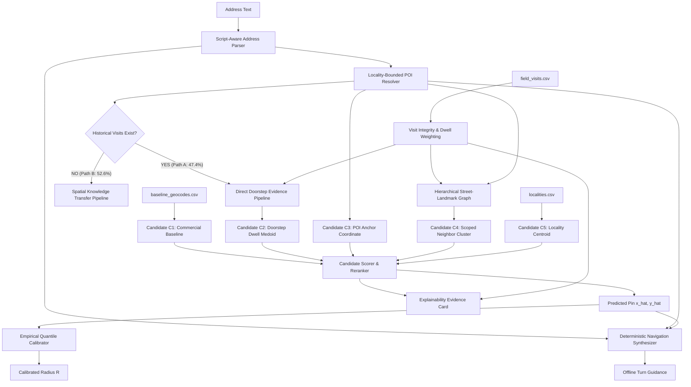

# PS3 Final Architecture Specification: NeuroGeo-Field
*Document 1 of 5: System Architecture & Design Authority*
*Status: FROZEN (Architecture Level)*

---

## 1. System Vision & Objective

CreditNirvana operates an AI-native collections platform across India where physical field visits cost ₹150–₹400 per touch. Descriptive, unstandardized Indian addresses cause commercial geocoders to default to locality or pincode centroids (median error 376.4m, 90th percentile 839.2m, up to 4.8 km), leading to **25.1% of visits ending in `address_not_traceable`**.

**NeuroGeo-Field** is an evidence-backed spatial inference engine that transforms raw descriptive address text, commercial priors, and operational field visit logs into:
1. **Accurate 2D Metric Coordinates $(\hat{x}, \hat{y})$** in meters.
2. **Calibrated Confidence Radius $R$** calibrated to target approximately 90% empirical operational coverage on held-out data.
3. **Discrete Prediction Status Tier** (`DOORSTEP_VERIFIED`, `STREET_RESOLVED`, `LOCALITY_BOUNDED`, `BASELINE_FALLBACK`).
4. **Offline, Deterministic Landmark Navigation Guidance**.
5. **Auditable Evidence Card** providing decision explainability.

---

## 2. Core Architectural Philosophy: Retrieve → Rank → Calibrate

We explicitly reject continuous coordinate regression with neural networks ($(x, y) = f(\text{text})$) because regression in unconstrained metric space produces unbounded predictions. Instead, we formulate geocoding as **discrete spatial hypothesis generation and evidence-weighted reranking**:

```
[Raw Address Text] + [Commercial Prior]
          │
          ▼
┌────────────────────────────────────────────────────────┐
│ 1. Address Understanding & Entity Resolution          │
│    • Script normalization (Kannada / Devanagari)       │
│    • Postal PIN parsing & assisted disambiguation      │
│    • Locality, Street, Landmark, Preposition NER       │
│    • Locality-bounded POI disambiguation               │
└──────────────────────────┬─────────────────────────────┘
                           │
                           ▼
┌────────────────────────────────────────────────────────┐
│ 2. Spatial Candidate Generation                        │
│    C1: Commercial Baseline Prior                       │
│    C2: Direct Visit Doorstep Medoid (if visited)       │
│    C3: POI Anchor Coordinate (with relational cues)    │
│    C4: Hierarchically Scoped Neighbor Street Cluster   │
│    C5: Locality Centroid Fallback                      │
└──────────────────────────┬─────────────────────────────┘
                           │
                           ▼
┌────────────────────────────────────────────────────────┐
│ 3. Candidate Scoring & Reranking                       │
│    • Text-spatial semantic alignment                   │
│    • Direct doorstep evidence (met_family, locked)     │
│    • Neighbor support volume                           │
│    • Negative search penalties (address_not_traceable) │
│    • Commercial prior agreement                        │
└──────────────────────────┬─────────────────────────────┘
                           │
                           ▼
┌────────────────────────────────────────────────────────┐
│ 4. Uncertainty Calibration & Operational Outputs       │
│    • 5-level hierarchical empirical quantile radius R  │
│      (C2 doorstep, landmark scale, candidate P90,      │
│       locality P90, evidence-tier fallback)            │
│    • Prediction status assignment                      │
│    • Deterministic offline turn directions             │
│    • Machine-readable evidence card                    │
└────────────────────────────────────────────────────────┘
```

---

## 3. Explicit Dual-Path Inference Engine

Empirical audit confirms that **52.6% of addresses (1,640 of 3,117) have NEVER been visited**, and **51 of the 100 surveyed benchmark addresses have ZERO visits**. The architecture must enforce two distinct inference pathways:



### Path A: Visited Address Pipeline (Direct Operational Evidence)
1. Ingest historical visits for the target address.
2. Filter through the **Visit Integrity Engine** ($I_v$) to penalize photo collisions and short drive-bys.
3. Compute the **Doorstep Dwell Medoid** using high-confidence positive outcomes (`met_family`, `locked_premises`, `met_borrower`).
4. Generate Candidate $C_2$ with high prior weighting.

### Path B: Cold-Start Unvisited Pipeline (Spatial Knowledge Transfer)
1. Parse extracted locality, normalized street/cross, and relative landmarks.
2. Query the **Hierarchical Spatial Graph** for visited neighbor accounts matching `(town_id, locality_id, normalized_street)`.
3. Disambiguate extracted landmarks against `landmarks_poi.csv` using locality bounding.
4. Generate Candidates $C_3$ (POI anchor coordinate), $C_4$ (neighbor cluster centroid weighted by visit integrity and spatial evidence strength), $C_1$ (commercial baseline), and $C_5$ (locality centroid).
5. Rerank candidates using text-spatial agreement and neighborhood density.

---

## 4. The 4 System Outputs & Prediction Status Tiers

Every prediction returns an atomic schema containing:
1. `predicted_x`, `predicted_y`: Floating-point coordinates in local Cartesian meters.
2. `confidence_radius_m`: Float radius in meters targeting approximately 90% empirical coverage on held-out data.
3. `prediction_status`: Categorical enum reflecting spatial certainty.
4. `offline_navigation_guidance`: Human-readable turn directions.
5. `evidence_card`: Structured dictionary detailing exact feature contributions.

### The 4 Prediction Status Tiers

| Status Tier | Operational Meaning | Initial Operational Target Radius | Field Operations Action |
| :--- | :--- | :---: | :--- |
| `DOORSTEP_VERIFIED` | Confirmed by $\ge 1$ high-integrity doorstep visits (`met_family`, `locked_premises`). | $R \le 35\text{m}$ | Dispatch field agent directly to pin. |
| `STREET_RESOLVED` | Cold-start, but street and landmark anchored via visited neighbor accounts. | $R \le 85\text{m}$ | Dispatch agent with landmark guidance cues. |
| `LOCALITY_BOUNDED` | Unvisited, descriptive text only resolves to neighborhood/locality centroid. | $R \le 250\text{m}$ | Withhold dispatch; send for tele-verification first. |
| `BASELINE_FALLBACK` | Pincode fallback, contradictory text, or unresolved entities. | $R > 400\text{m}$ | Flag as high-risk untraceable address. |

> **Operational Threshold Contract**: The 4 categorical status tiers (`DOORSTEP_VERIFIED`, `STREET_RESOLVED`, `LOCALITY_BOUNDED`, `BASELINE_FALLBACK`) are architecturally frozen. The numerical radius bounds ($35\text{m}, 85\text{m}, 250\text{m}, 400\text{m}$) represent initial operational engineering design targets; final operational status thresholds are empirically derived from calibration distributions.

---

## 5. Non-Goals & Architectural Boundaries

1. **No End-to-End Deep Metric Learning**: We do not fine-tune XLM-RoBERTa or IndicBERT on the 3,117 raw address strings. Character n-gram TF-IDF and structured entity matching provide higher precision without representation collapse.
2. **No Neural Graph Networks (GNNs)**: Graph knowledge transfer uses sparse bipartite adjacency propagation (NetworkX / SciPy); neural message passing is out of scope.
3. **No Unconstrained Online Learning**: The spatial knowledge base updates in versioned, integrity-gated batch cycles, never mutating production coordinates on single raw check-ins.
4. **No Generative LLM Navigation**: Navigation text is synthesized via deterministic templates to guarantee sub-millisecond offline execution and zero hallucinations.
5. **Empirically Calibrated Production Hierarchy**: The production calibration engine integrates candidate-specific empirical P90 bounds and close-landmark spatial-scale geometry ($G_i = \max(\|P_i - L_0\|_2, d_{\min}, 15.0\text{m})$) with multi-level fallbacks (locality P90, evidence-tier empirical quantiles), rigorously evaluated via 5-fold grouped CV on 1,428 held-out SCV episodes (achieving 89.57% aggregate coverage). Benchmark surveyed target coordinates and test error residuals were never accessed, fitted, or evaluated. Target doorstep evidence (C2) remains strictly preserved at 35m as an operational direct-doorstep engineering policy.
