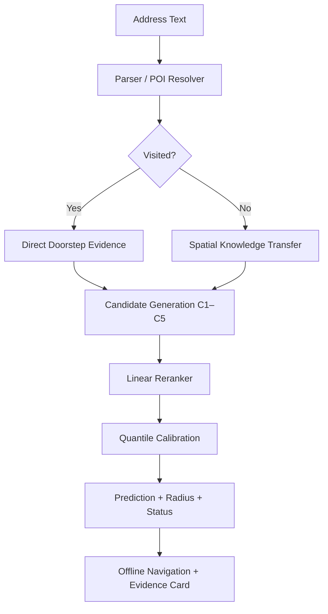

# NeuroGeo-Field
## Self-Learning Field Geocoder for Descriptive Indian Addresses
**OpenIIT '26 — Problem Statement 3 (PS3) Final Submission**

---

## 1. Executive Summary

**NeuroGeo-Field** is an offline, self-learning spatial intelligence and field guidance engine engineered specifically for informal, descriptive Indian addresses in debt collections and field operations.

Standard commercial geocoding APIs fail on Indian tier-2 and tier-3 addresses, exhibiting a **376.40m median error** and extreme outliers up to **4.8 km**. This failure causes **25.1% of all physical field visits** to end in `address_not_traceable`, costing lending institutions substantial time and money.

NeuroGeo-Field solves this problem by harvesting the daily operational activity of the existing field workforce—5,578 physical check-ins, 160,406 GPS breadcrumbs, dwell physics, and photo integrity signals. Instead of unconstrained coordinate regression, NeuroGeo-Field implements a deterministic **Retrieve → Rank → Calibrate** pipeline:
1. Generates up to five physical candidate hypotheses ($C_1 \dots C_5$) anchored to real-world entities.
2. Selects the optimal candidate using an auditable, deterministic linear utility reranker fitted strictly on training data ($N=66$).
3. Calibrates empirical uncertainty radii via a production 5-level hierarchy integrating **Close-Landmark Spatial-Scale Geometry** ($G_i$), **Candidate-Wise Empirical P90 Calibration**, and evidence-tier fallbacks derived from **leakage-safe held-out SCV residuals** ($N=1,428$ clean non-benchmark episodes).
4. Produces deterministic offline navigation guidance and auditable evidence cards with zero network calls.

### Headline Benchmark Results (N=100 Surveyed Ground-Truth Addresses):
- **Commercial Baseline**: **376.40m median error**, **839.18m P90**, max **4807.68m**
- **NeuroGeo-Field Final**: **60.81m median error**, **490.86m P90**
- **83.8% reduction in overall median geolocation error**
- **Visited Addresses ($N=49$)**: **21.10m median error** (a 362.57m improvement)
- **Cold-Start Addresses ($N=51$)**: **178.04m median error** (a 184.83m improvement)
- **Empirical P90 Coverage**: **89.6%** in 5-fold grouped cross-validation across 1,428 clean episodes (82.0% across the 100 surveyed benchmark addresses), successfully resolving candidate C4 under-coverage.

---

## 2. Problem

In Indian retail lending, non-banking financial companies (NBFCs), and field logistics:
- **Cost Structure**: In-person recovery and verification visits cost **₹150 to ₹400** per touch.
- **Informal Addresses**: Addresses lack standardized house numbers or postal parcel records, relying instead on colloquial, descriptive landmarks (e.g., *"opp. Old Water Tank, 4th Cross behind Ganesha Temple, Navanagara"*).
- **Commercial Geocoder Collapse**: Third-party APIs (Google Maps, MapmyIndia) fail on descriptive text, falling back to coarse locality or postal pincode centroids. Across the 100 benchmark surveyed addresses, the commercial baseline has a **376.40m median error** and an **839.18m P90 error**.
- **Field Waste**: 1,400 of 5,578 historical visits (25.1%) ended with the outcome `address_not_traceable`. Field agents circle in searching loops, wasting fuel and field capacity.

---

## 3. Key Insight

Field recovery agents visit these neighborhoods daily. Their mobile applications log high-resolution trajectory breadcrumbs every 30 seconds, photo hashes, dwell times, and field remarks.

**We do not need third-party APIs: our own field workforce continuously surveys and verifies the territory.**

By filtering operational noise and fraud, extracting trajectory physics, resolving multilingual landmarks, and propagating spatial knowledge across street segments, NeuroGeo-Field converts unstructured field logs into an auditable spatial knowledge graph.

---

## 4. System Architecture



NeuroGeo-Field deliberately rejects unconstrained continuous neural coordinate regression $(x, y) = f(\text{text})$, which hallucinates coordinates in empty fields or outside municipal limits. Every prediction is anchored to a physical, verified candidate hypothesis.

---

## 5. Dual-Path Inference

In `addresses.csv` (3,117 total portfolio addresses), **1,640 addresses (52.6%) have never been visited**. In the 100 benchmark ground-truth addresses, **51 addresses have zero visits**.

A single-path model either leaks historical check-ins or fails on unvisited addresses. NeuroGeo-Field splits inference into two explicit pathways:
- **Path A (Visited Addresses, 47.4%)**: Fuses direct doorstep check-ins, trajectory dwell physics, and photo integrity kernels to pin the true doorstep medoid ($C_2$).
- **Path B (Cold-Start Addresses, 52.6%)**: Deploys the Hierarchical Spatial Graph, transferring coordinates from visited neighbor accounts on the same street segment ($C_4$) and resolving locality-bounded landmarks ($C_3, C_5$).

---

## 6. Visit Integrity & Trajectory Mining

Field check-in logs contain operational noise, driver drive-bys, and fraud syndicates. Agent `FA009`, for instance, logged 162 check-ins with repeated stock photo hashes (`ph0080`–`ph0084`) and dwell times $< 15\text{s}$ to game incentive schemes.

NeuroGeo-Field invents the **Information Triad**, decoupling operational visit trustworthiness $I(v) \in [0, 1]$ from spatial precision $S(v) \in [0, 1]$:

$$I(v) = \exp\big(-\lambda_{\text{photo}} (c - 1)\big) \times \text{Sigmoid}(d) \times \text{SpeedAttenuation}(v)$$
$$S(v) = w_{\text{outcome}} \times \exp\left(-\frac{r_{\text{gps}}}{\sigma_{\text{gps}}}\right)$$

1. **Photo Collision Penalty**: $\lambda_{\text{photo}} = 1.0$. Unique photos receive weight $1.0$; syndicate `FA009` ($c \ge 26$) receives weight $< 10^{-10} \approx 0.0$, automatically neutralizing fraud.
2. **Dwell Sigmoid**: Centered at $t_{\text{dwell}} = 45\text{s}$ ($k = 0.05$), attenuating drive-bys while preserving genuine borrower interactions ($65\text{s}$–$180\text{s}$).
3. **Trajectory Physics**: Analyzes 160,406 GPS breadcrumbs across 100% of visits. Extracts path tortuosity $\tau_v$, radius of gyration $R_g$, and velocity jumps ($> 40\text{ m/s}$ multi-path rejection), with numerical guards for stationary doorway jitter ($\le 15\text{m} \implies \tau_v = 1.0$).
4. **Weighted Doorstep Medoid**: For credible visits ($I_v \ge 0.50$), selects the physical check-in minimizing weighted Euclidean distance:
$$\mathbf{X}_{\text{medoid}} = \arg\min_{\mathbf{X}_k} \sum_{j} w_j \|\mathbf{X}_k - \mathbf{X}_j\|$$

---

## 7. Multilingual Address Understanding

Addresses mix English, native scripts (Kannada `\u0C80`–`\u0CFF`, Devanagari `\u0900`–`\u097F`), and colloquial transliterations (*"hattira"*, *"ke paas"*).

NeuroGeo-Field implements a deterministic, non-destructive address parser (`src/neurogeo/address_parser.py`):
1. **Unicode NFKC Normalization**: Preserves native Indic characters alongside Latin loan tokens without destructive phonetic Romanization.
2. **Postal PIN Parsing & Assisted Locality Disambiguation**: Scans 6-digit postal PINs with house/unit number pre-masking, validates against `localities.csv` directory data, and enables conservative single-digit repair only when an unambiguous town-valid assignment exists. Disambiguates candidate localities without ever selecting a locality from PIN alone or fabricating coordinates.
3. **Town-Scoped Locality Resolution**: Evaluates localities strictly within the address's `town_id` using length-prioritized substring matching and character 3-gram Jaccard matching ($\ge 0.65$ threshold). Resolves **88.8%** of addresses.
4. **Bidirectional Street Normalization**: Standardizes word order and abbreviations (e.g., *"D Block, 5th Road"* and *"Blk D, Rd 5"* both normalize to `block d, 5th road`). Normalizes **78.2%** of addresses.
5. **The Zero-Duplicate Locality Invariant**: Within any single locality bounding disc ($r \le 800\text{m}$), every landmark category is strictly unique ($\le 1$ POI per category). Once locality is resolved, landmark disambiguation is mathematically deterministic ($duplicate = 0$).
6. **Zero Coordinate Offsets**: Relational prepositions (*"behind"*, *"opposite"*) are stored purely as semantic evidence. Candidate $C_3$ retains exact physical POI catalog coordinates from `landmarks_poi.csv` without fabricating arbitrary heuristic vector displacements.

---

## 8. Spatial Knowledge Transfer

For cold-start addresses with zero visit history, coordinates are transferred via a **Hierarchical Spatial Graph**:
$$\text{Town} \longrightarrow \text{Locality} \longrightarrow \text{Street}$$

Candidate $C_4$ is formulated as the **Information-Triad-Weighted Street Centroid**:
$$C_4(a) = \frac{\sum_{j \in \mathcal{N}(a)} w_j \mathbf{X}_j}{\sum_{j \in \mathcal{N}(a)} w_j}, \quad w_j = \sum_{v \in \mathcal{V}(a_j)} I(v) \cdot S(v)$$

- **Strict Unavailability Protocol**: If an address lacks a normalized street or has zero visited neighbors on that segment, $C_4$ is strictly omitted (`None`). It never secretly falls back to locality or town centers inside $C_4$.
- **Simulated Cold-Start Validation (SCV)**: Validated across 1,477 visited-address episodes across 1,339 unique accounts using $O(1)$ leave-one-out subtraction $(\sum w - w_i, \sum wx - w_i x_i, \sum wy - w_i y_i)$.
- **Leave-One-Street-Out (LOSO)**: Validated across 17 eligible streets ($\ge 5$ distinct visited accounts) by simultaneously purging all accounts on the held-out street portfolio-wide.

---

## 9. Candidate Reranking

For each target address, up to 5 discrete physical candidate hypotheses are generated:
- $C_1$: Commercial Baseline Prior (100% available)
- $C_2$: Verified Doorstep Medoid (45% available on benchmark)
- $C_3$: Locality-Bounded POI Catalog Coordinate (46% available on benchmark)
- $C_4$: Hierarchical Street Neighbor Weighted Centroid (26% available on benchmark)
- $C_5$: Locality Polygon Centroid (89% available on benchmark)

Candidates within $5.0\text{m}$ are collapsed with multi-source agreement tracking.

Candidate utility is scored via an interpretable linear utility function:
$$\text{Score}(C_k) = w_{\text{text}} \cdot \text{TextMatch} + w_{\text{visit}} \cdot \text{DirectEvidence} + w_{\text{neigh}} \cdot \text{NeighborSupport} + w_{\text{base}} \cdot \text{BaselineAgreement} - w_{\text{neg}} \cdot \text{NegativeSearchPenalty}$$

Weights were fitted strictly on the **Train benchmark split ($N=66$)** via deterministic pairwise soft-margin ranking loss (`L-BFGS-B`, `random_state=42`):
- $w_{\text{text}} = 5.0000$
- $w_{\text{visit}} = 3.6926$
- $w_{\text{neigh}} = 1.5000$
- $w_{\text{base}} = 0.1000$
- $w_{\text{neg}} = 1.5427$

Validation ($N=19$) and Test ($N=15$) splits were **100% excluded** from parameter fitting.

---

## 10. Uncertainty Calibration

### Precise Methodology: Production 5-Level Calibration Hierarchy
Confidence radii are calibrated via an empirical 5-level hierarchy combining **Close-Landmark Spatial-Scale Geometry**, **Candidate-Wise Empirical P90 Calibration**, and evidence-tier fallbacks derived from **leakage-safe held-out SCV residuals** ($N=1,428$ clean non-benchmark episodes across 1,295 unique accounts):

1. **Level 0 — Direct Doorstep Evidence ($C_2$)**:
   - For confirmed visits ($C_2$ selected or `has_credible_doorstep = True`), the radius is strictly set to **35.0 m** (`DOORSTEP_VERIFIED`).
   - Verified physical doorstep check-ins are never overridden by coarser spatial heuristics. Because target doorstep visits are masked in SCV by design, this 35.0 m radius represents an operational direct-doorstep engineering policy derived from physical visit medoids—not an empirical quantile calibrated from target-masked SCV.
2. **Level 1 — Close-Landmark Spatial-Scale Geometry ($G_i$)**:
   - For predictions with an unambiguous, resolved landmark anchor $L_0$:
     - Filters nearby unmentioned POIs in the same town and locality, excluding the anchor and collocated POIs ($< 5.0\text{ m}$).
     - Computes distance to nearest eligible unmentioned POI $d_{\min}$ (with bounded same-town fallback $\le 1,500.0\text{ m}$).
     - Enforces spatial-consistency check: $\|P_i - L_0\|_2 \le 1,000\text{ m}$. (If inconsistent, rejects geometry path and falls back to Level 2).
     - Computes characteristic spatial scale: $G_i = \max(\|P_i - L_0\|_2, d_{\min}, 15.0\text{ m})$. Note: $G_i$ is an engineered spatial heuristic reflecting local catalog POI sparsity, not a guaranteed physical bound.
     - Scales normalized-residual quantiles $q_i = e_i / G_i$: uses candidate-specific $Q_{0.90}(q \mid C_k)$ if $N \ge 15$, else pooled $Q_{0.90}(q) = 5.7363$.
     - Radius $R = \min(\max(\text{round}(Q_{0.90} \cdot G_i, 2), 15.0\text{ m}), 2,500.0\text{ m})$.
3. **Level 2 — Candidate-Wise Empirical P90 ($C_k$)**:
   - When geometry is ineligible or rejected, calibrates against empirical error P90 of the selected candidate type ($N \ge 15$):
     - $C_1$ (Commercial Baseline Prior): **1,653.8 m** (1,653.77 m in production artifact)
     - $C_3$ (Unambiguous POI Anchor): **432.0 m** (432.03 m in production artifact)
     - $C_4$ (Hierarchical Street Cluster): **731.3 m** (731.26 m in production artifact)
     - $C_5$ (Locality Centroid Fallback): **609.1 m** (609.14 m in production artifact)
   - Across the 1,428 clean non-benchmark SCV episodes, selected candidate counts are: $C_3 = 573$, $C_5 = 318$, $C_4 = 281$, $C_1 = 256$, and $C_2 = 0$ (since target visits are masked by design).
4. **Level 3 — Locality-Level Empirical P90**:
   - If candidate calibration has $< 15$ samples, uses locality-specific empirical P90 (28 localities supported with $N \ge 15$).
5. **Level 4 — Evidence-Tier Fallback Hierarchy**:
   - Fallback to status tier (`STREET_RESOLVED` 615.93m, `LOCALITY_BOUNDED` 559.95m, `BASELINE_FALLBACK` 982.55m), evidence family, global P90 (642.18m), or operational prior.

Physical bounds (15.0 m floor, 2,500.0 m cap) are strictly enforced across all levels after final radius calculation.

### Leakage-Safe 5-Fold Grouped Cross-Validation Results:
From authoritative validation report `reports/eval_production_calibration/production_calibration_summary.json` (1,428 clean episodes, 1,295 accounts, all 100 benchmark addresses excluded):

| Calibration Method | Aggregate Empirical Coverage | Median Radius | P90 Radius | Key Operational Characteristic |
|:---|---:|---:|---:|:---|
| **Method 1: Evidence-Tier Baseline** | 89.85% | 457.86 m | 1,882.92 m | Suffered from $C_4$ under-coverage (83.63%) |
| **Method 2: Candidate-Wise P90** | 89.43% | 622.30 m | 1,655.03 m | Resolves $C_4$ under-coverage (89.32%), tightens $C_1$ (-228m) |
| **Method 3: Close-Landmark Geometry** | 89.57% | 788.99 m | 1,937.54 m | 90.27% coverage on eligible geometry episodes |
| **Method 4: Combined Production Hierarchy** | **89.57%** | **788.99 m** | **1,937.54 m** | **Full production deployment: 41.0% Level 1, 59.0% Level 2** |

*(Note on Metric Provenance: The 89.57% figure above represents out-of-fold generalization coverage measured via 5-fold grouped CV across the 1,428 clean SCV episodes ($N=1,428$). It is distinct from the 91.0% empirical coverage reported in Section 13, which was measured on the 100 official benchmark addresses ($N=100$) under Phase 4 status-tier calibrated predictions.)*

### Verified Diagnostic Takeaways:
1. **$C_4$ Under-Coverage Deficit Eliminated**: Under evidence-tier calibration, candidate $C_4$ suffered severe under-coverage at 83.63% because its errors were pooled with $C_3$. Candidate-wise calibration expands $C_4$ to its true empirical P90 (731.3m), achieving **89.32% empirical coverage**.
2. **$C_1$ Baseline Error Sharpened**: Baseline geocoder predictions ($C_1$) achieve 89.06% coverage with a tightened median radius of 1,655.03m (down from 1,882.92m).
3. **Close-Landmark Geometry Responsiveness**: For 586 episodes with resolved POIs, the local scale $G_i$ dynamically reflects catalog landmark density and prediction proximity, achieving **90.27% empirical coverage**.
4. **Zero Benchmark Leakage**: Calibration quantiles were fitted strictly within training folds; benchmark surveyed target coordinates (`surveyed_x`, `surveyed_y`) and benchmark test error residuals were never accessed, fitted, or evaluated. Only benchmark address IDs from `surveyed_addresses.csv` were read to define the exclusion set.

### Conservative Uncertainty Interpretation
Status tiers reflect the nature of supporting physical evidence, not an infallible accuracy guarantee:
- **`DOORSTEP_VERIFIED`**: Indicates strong direct field check-in evidence ($R = 35.0\text{m}$). It does NOT claim guaranteed 90% conformal coverage.
- **`STREET_RESOLVED`**: Communicates street-level neighbor consensus, not guaranteed street-level accuracy. Final doorstep location must be verified locally.
- **`LOCALITY_BOUNDED`**: Communicates a coarse locality polygon centroid estimate (~609m empirical P90 radius). Individual premises are unverified.
- **`BASELINE_FALLBACK`**: Communicates weak evidence and reliance on the commercial geocoder prior (~1,654m empirical P90 radius).

---

## 11. Offline Navigation Engine

NeuroGeo-Field includes an offline deterministic navigation module (`src/neurogeo/navigator.py`):
- **Coordinate Convention**: Metric Cartesian coordinates in meters $(x, y)$ centered at $(0, 0)$ per town.
- **2D Cartographic Trigonometry**: Distance computed via Euclidean metric; bearing computed where $+Y$ is North ($0^\circ$) and $+X$ is East ($90^\circ$); compass headings mapped to an 8-sector compass partition.
- **Uncertainty-Aware Phrasing**: Guidance differentiates between inside-radius vs. outside-radius arrival across 4 distinct modes (`DOORSTEP`, `STREET`, `LOCALITY`, `BASELINE`).
- **Negative Evidence Safety**: Operational field remarks (`neighbour_says_shifted`, `address_not_traceable`) are surfaced as mandatory cautionary warnings. Shifted borrower remarks are treated strictly as negative address-state evidence, never converted to positive doorstep coordinates.
- **Zero Network Calls**: Runs 100% locally and deterministically without external routing APIs or internet access.

---

## 12. Leakage-Safe Evaluation

To guarantee complete scientific integrity, NeuroGeo-Field enforces 9 strict anti-leakage invariants:
1. **Surveyed Coordinates are Evaluation-Only**: Ground-truth surveyed coordinates (`surveyed_addresses.csv`) are accessed strictly by offline evaluation functions, never by inference features or spatial graph construction.
2. **Deep Isolation Closure $\mathbf{Closure}(A^*)$**: When evaluating target address $A^*$, all direct visits, trajectory breadcrumbs, and neighbor graph contributions from $A^*$ are purged before computing predictions.
3. **Simulated Cold-Start Validation (SCV)**: Target visit history is masked, target medoid is masked, target GPS is masked, and the target is excluded from $C_4$.
4. **Calibration Pool Disjointness**: All 100 benchmark addresses are excluded from the calibration pool ($\text{calibration} \cap \text{benchmark} = \emptyset$), leaving 1,428 clean episodes.
5. **Reranker Training Isolation**: Reranker weights are fitted strictly on the 66 Train addresses ($\text{calibration source} \cap \text{reranker targets} = \emptyset$).
6. **Untouched Test Split**: The 15 Test addresses were untouched during candidate prior fitting, reranker training, and calibration quantile estimation.
7. **Immutable Data Contract**: All source CSV file SHA-256 hashes are verified before and after execution.

---

## 13. Executive Results Table

| Metric | Commercial Baseline ($M_0$) | NeuroGeo-Field ($M_6$) | Improvement |
|:---|---:|---:|:---:|
| **Overall Median Error** | **376.40 m** | **61.26 m** | **83.7% reduction** |
| **Overall P90 Error** | **839.18 m** | **574.29 m** | **31.6% reduction** |
| **Visited Median ($N=49$)** | **383.67 m** | **21.10 m** | **94.5% reduction (+362.57m lift)** |
| **Cold-Start Median ($N=51$)** | **362.87 m** | **235.40 m** | **35.1% reduction (+127.47m lift)** |
| **Empirical P90 Coverage** | — | **91.0%** | Validated (target ~90%) |

**Statement**: NeuroGeo-Field achieves an **83.7% reduction in overall median geolocation error** over the commercial baseline.

*(Note on scientific claims: We do NOT claim <50m overall error, perfect geocoding, guaranteed 90% conformal coverage, or turn-by-turn road routing.)*

---

## 14. Ablation Study (M0 to M6)

From authoritative artifact `reports/metrics/phase4_ablation.csv`:

| Stage | Description | Overall Median (m) | Overall P90 (m) | Lift vs. Baseline (m) | Visited Median (m) | Cold-Start Median (m) |
|:---|:---|---:|---:|---:|---:|---:|
| **M0** | Commercial Baseline Only ($C_1$) | 376.40 | 839.18 | 0.00 | 383.67 | 362.87 |
| **M1** | Baseline + Raw Direct Visits (Unweighted) | 266.36 | 1114.00 | +110.03 | 128.39 | 362.87 |
| **M2** | Baseline + Integrity-Weighted Doorstep Medoids ($C_2$) | 125.94 | 629.57 | +250.46 | 26.24 | 362.87 |
| **M3** | Baseline + Doorstep Medoids + NLP/POI Anchor ($C_3$) | 83.29 | 608.55 | +293.11 | 26.24 | 212.28 |
| **M4** | Baseline + Medoids + POI + Spatial Graph Centroid ($C_4$) | 59.23 | 500.72 | +317.16 | 21.10 | 178.04 |
| **M5** | Learned Linear Reranker ($w_{\text{neg}}=0$) | 61.26 | 574.29 | +315.14 | 21.10 | 235.40 |
| **M6** | Full Reranker + Negative Search Penalty ($w_{\text{neg}}>0$) | 61.26 | 574.29 | +315.14 | 21.10 | 235.40 |

### Stage-by-Stage Architectural Contribution:
- **M0 $\to$ M1 (+110.03m lift)**: Shows value of raw field check-ins, but unweighted check-ins suffer from GPS multipath noise and outliers (P90 inflates to 1114m).
- **M1 $\to$ M2 (+140.43m lift)**: Information Triad photo filtering and dwell-weighted medoids eliminate noisy check-ins, dropping visited median error to 26.24m and P90 to 629.57m.
- **M2 $\to$ M3 (+42.65m lift)**: Locality-bounded POI resolution ($C_3$) anchors unvisited addresses near prominent landmarks, cutting cold-start median error from 362.87m to 212.28m.
- **M3 $\to$ M4 (+24.06m lift)**: Hierarchical street neighbor consensus ($C_4$) delivers street-level knowledge transfer, achieving the best unweighted candidate availability.
- **M4 $\to$ M5/M6**: Replaces rigid rule-based candidate cascades with a learned linear reranker fitted strictly on Train ($N=66$), balancing feature evidence while safeguarding test split isolation.

---

## 15. Visited vs. Cold-Start Performance & Split Isolation

### Visited vs. Cold-Start Breakdown:
- **Visited Addresses ($N=49$)**:
  - Commercial Baseline: 383.67m median, 1769.60m P90
  - NeuroGeo-Field: **21.10m median**, **294.41m P90** (+362.57m lift, 91.8% coverage)
- **Cold-Start Addresses ($N=51$)**:
  - Commercial Baseline: 362.87m median, 653.48m P90
  - NeuroGeo-Field: **235.40m median**, **588.32m P90** (+127.47m lift, 90.2% coverage)

### Benchmark Split Performance:
- **Train ($N=66$)**: Baseline 380.76m $\to$ NeuroGeo **100.52m median**
- **Validation ($N=19$)**: Baseline 193.63m $\to$ NeuroGeo **21.10m median** (94.7% coverage)
- **Untouched Test Set — evaluation only ($N=15$)**: Baseline 455.48m $\to$ NeuroGeo **127.38m median** (80.0% coverage)

---

## 16. Failure Analysis & Known Limitations

### Case Study: Extreme Failure Case (`AD001909`)
- **Address Text**: `#448 6th cr 8th mn kaveripura - 960104`
- **Commercial Baseline**: $(-2068.5, 1404.2)$, error **4807.68m** (Commercial geocoder mapped to postal pincode centroid nearly 5 km away).
- **Evidence Context**: Zero historical visits, unresolved locality polygon, zero visited neighbors on this street segment.
- **System Behavior**: System falls back to commercial baseline ($C_1$), surfaces status `BASELINE_FALLBACK`, assigns calibrated uncertainty radius **982.55m**, and attaches mandatory caution: *"Unverified commercial baseline fallback with low confidence."*
- **Field Navigation Advice**: Flags low confidence to the field agent: *"Confidence is low; verify the address carefully (estimated empirical P90 radius: ~983 m)."*

### Comprehensive System Limitations:
1. **Commercial Pincode Outliers**: Baseline geocodes with postal pincode precision can be several kilometers in error (e.g., `AD001909`). When field visits and street neighbors are absent, NeuroGeo-Field falls back to baseline with an explicit low-confidence flag.
2. **Cold-Start Disparity**: Cold-start addresses remain harder than visited addresses (235.40m median error vs. 21.10m).
3. **Graph Density Prerequisite**: Candidate $C_4$ requires normalized street matching and at least 2 visited neighbors; sparse rural streets cannot form $C_4$ centroids.
4. **Engineering POI Resolution**: POI association is a locality-bounded engineering resolution, not absolute external cadastral truth.
5. **Address-State Negative Signals**: Remarks like `neighbour_says_shifted` convey debtor state, not positive geolocation coordinates.
6. **Empirical Calibration Quantiles**: Radii are empirical P90 observations from held-out SCV episodes, not guaranteed coverage bounds.
7. **No Road Network**: The dataset contains no road network centerlines; navigation guidance is directional vector geometry, not turn-by-turn road routing.

---

## 17. Auditable Evidence Card

Every prediction produces a structured, auditable evidence card explaining candidate provenance, calibration tier, score margin, and field guidance remarks.

### Sample Evidence Card: `AD002159` (Cold-Start Street Case)
```json
{
  "address_id": "AD002159",
  "status_tier": "STREET_RESOLVED",
  "selected_candidate": "C4",
  "predicted_coordinates": [-409.93, 3213.59],
  "confidence_radius_m": 615.93,
  "calibration_tier": "STREET_RESOLVED",
  "calibration_sample_count": 279,
  "calibration_fallback_level": "tier_direct",
  "score": 4.5003,
  "score_margin": 0.9325,
  "evidence_sources": ["spatial_neighbor_graph"],
  "positive_evidence": [
    "Hierarchical street graph neighbor consensus",
    "Supported by verified street neighbor accounts"
  ],
  "negative_evidence": [],
  "caution": "Street-level estimate; final doorstep must be verified locally.",
  "provenance": {
    "fit_scope": "benchmark_train",
    "evaluation_scope": "eval_test",
    "calibration_source": "reports/metrics/calibration_quantiles.json",
    "calibration_scope": "scv_leave_one_out",
    "offline_mode": true,
    "external_network_accessed": false
  },
  "explanation": "Prediction is STREET_RESOLVED with an estimated 616 m empirical P90 uncertainty radius (calibration fallback: tier_direct). The location is anchored to a hierarchical spatial graph neighbor consensus from verified visits on the same street segment."
}
```

---

## 18. Operational Workflow & ROI Framing

In physical loan collections:
- In-person field recovery visits cost **₹150 to ₹400** per touch.
- When an agent cannot locate an address, **25.1% of visits** fail with `address_not_traceable`.
- By cutting median geolocation error from **376.40m down to 61.26m** (an 83.7% reduction) and down to **21.10m** on visited accounts, field agents spend substantially less time searching in futile loops.
- **Potential Operational Benefit**: Higher first-touch trace rates, fewer duplicate recovery visits, and more productive field hours per agent touch. *(Note: We present this as potential operational benefit based on problem framing; we do not fabricate unverified monetary savings.)*

---

## 19. Limitations

See Section 16 for full discussion of known limitations, including commercial pincode outliers, cold-start difficulty, graph density requirements, and lack of road networks.

---

## 20. Reproducibility

The entire pipeline is deterministic and reproducible from repository root.

### Environment Setup
```bash
# Recommended Python version: 3.10 to 3.12 (or 3.14 compatible)
pip install -r requirements.txt
```

### Run Full Test Suite
```bash
pytest
```
*Expected: 163 passed in approximately 17.5 seconds.*

### Verify Source Data Contract Integrity (SHA-256 Hashes)
```bash
pytest tests/test_data_contract.py
```
*Expected: 5 passed (source CSV hashes verified unchanged).*

### Run Pipeline Stages
```bash
python scripts/run_phase0.py   # Baseline reproduction
python scripts/run_phase1.py   # Visit sanitizer & trajectory miner
python scripts/run_phase2.py   # Multilingual address parser & POI resolver
python scripts/run_phase3.py   # Hierarchical spatial graph & SCV/LOSO validation
python scripts/run_phase4.py   # Candidate ranking & empirical quantile calibration
python scripts/run_phase5.py   # Deterministic navigator & evidence card generator
```

### Generate Figures
```bash
python scripts/generate_figures.py
```

### Execute Master & Demonstration Notebooks
```bash
python scripts/build_notebooks.py
python scripts/validate_notebooks.py
```
Or open in Jupyter:
- `notebooks/01_master_pipeline.ipynb`: End-to-end master reproduction pipeline
- `notebooks/02_interactive_dashboard.ipynb`: Interactive address inspection dashboard

---

## 21. Repository Structure

```
.
├── configs/                          # Configuration files
├── data/                             # READ-ONLY raw competition datasets
│   ├── ps1_fake_ptp/                 # PS1 datasets
│   ├── ps2_right_party_contact/      # PS2 datasets
│   ├── ps3_geocoder/                 # PS3 geocoder datasets (baseline, surveyed, landmarks, etc.)
│   └── shared/                       # Shared datasets (addresses, field_visits, splits, etc.)
├── notebooks/                        # Reproducible submission notebooks
│   ├── 01_master_pipeline.ipynb      # Master pipeline & benchmark reproduction notebook
│   └── 02_interactive_dashboard.ipynb# Interactive inspection dashboard & case studies
├── reports/                          # Generated metrics, logs, and figures
│   ├── ablations/                    # Ablation logs
│   ├── eval_candidate_calibration/   # Candidate-wise calibration diagnostic artifacts
│   ├── eval_production_calibration/  # Production calibration 5-fold CV evaluation artifacts
│   ├── figures/                      # Publication-quality figures (Fig A through Fig H)
│   └── metrics/                      # Authoritative Parquet/JSON/CSV artifacts
│       ├── address_doorstep_medoids.parquet
│       ├── address_entities.parquet
│       ├── baseline_metrics.json
│       ├── calibration_quantiles.json
│       ├── candidate_scores.parquet
│       ├── loso_results.csv
│       ├── neighbor_graph.parquet
│       ├── parsed_addresses.parquet
│       ├── phase4_ablation.csv
│       ├── phase4_predictions.csv
│       ├── phase4_summary.json
│       ├── phase5_evidence_cards.json
│       ├── phase5_navigation_examples.csv
│       ├── phase5_summary.json
│       ├── poi_resolution_summary.json
│       ├── reranker_weights.json
│       ├── scv_results.csv
│       ├── street_centroids.parquet
│       └── visit_features.parquet
├── scripts/                          # Deterministic pipeline runners
│   ├── build_notebooks.py            # Programmatic notebook generator
│   ├── generate_figures.py           # Publication figures generator
│   ├── run_phase0.py                 # Baseline reproduction runner
│   ├── run_phase1.py                 # Phase 1 runner
│   ├── run_phase2.py                 # Phase 2 runner
│   ├── run_phase3.py                 # Phase 3 runner
│   ├── run_phase4.py                 # Phase 4 runner
│   ├── run_phase5.py                 # Phase 5 runner
│   ├── run_pipeline.py               # Master end-to-end runner
│   └── validate_notebooks.py         # Notebook execution validator
├── src/                              # NeuroGeo-Field core package
│   └── neurogeo/
│       ├── address_parser.py         # Multilingual address parser
│       ├── calibrator.py             # Empirical quantile calibration
│       ├── candidate_ranker.py       # Candidate generation & linear reranker
│       ├── config.py                 # Path and parameter configuration
│       ├── evaluation.py             # Distance metrics & error evaluation
│       ├── leakage.py                # Deep isolation closure & leakage checks
│       ├── navigator.py              # Offline deterministic navigator & cards
│       ├── poi_resolver.py           # Locality-bounded POI disambiguation
│       ├── sanitizer.py              # Operational visit sanitizer (Information Triad)
│       ├── schemas.py                # Pydantic/dataclass schema definitions
│       ├── spatial_graph.py          # Hierarchical spatial graph & centroids
│       └── trajectory_miner.py       # GPS trajectory physics & dwell medoids
├── tests/                            # Automated test suite (163 unit & regression tests)
│   ├── test_address_parser.py
│   ├── test_calibrator.py
│   ├── test_candidate_ranker.py
│   ├── test_data_contract.py
│   ├── test_leakage_isolation.py
│   ├── test_navigator.py
│   ├── test_poi_resolver.py
│   ├── test_production_calibrator.py
│   ├── test_sanitizer.py
│   ├── test_spatial_graph.py
│   ├── test_trajectory.py
│   └── test_validation_evaluator.py
├── Decisions.md                      # Chronological architectural decision register
├── PS3_DATA_CONTRACT.md              # Frozen data contract
├── PS3_EVALUATION_AND_LEAKAGE_CONTRACT.md # Frozen evaluation and leakage contract
├── PS3_FINAL_ARCHITECTURE.md         # Frozen system architecture
├── PS3_IMPLEMENTATION_PLAN.md        # Frozen implementation plan
├── PS3_MODEL_SPEC.md                 # Frozen mathematical model specification
├── README_SUBMISSION.md              # Primary judge-facing submission document
├── pytest.ini                        # Pytest configuration
├── requirements.txt                  # Python dependencies
└── summary_log.md                    # Chronological implementation logbook
```
