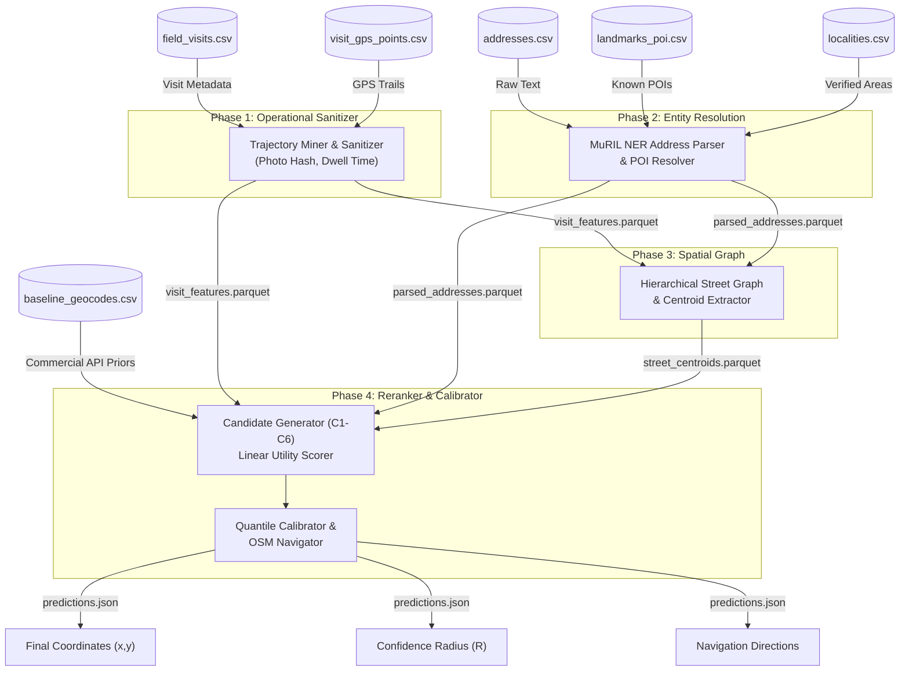
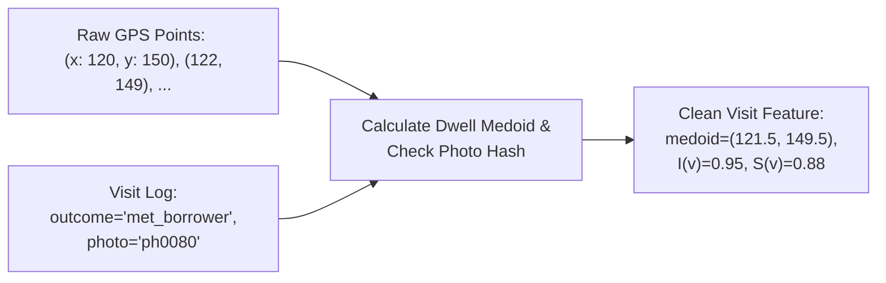
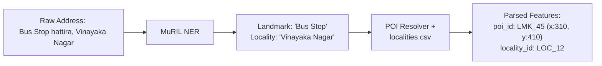
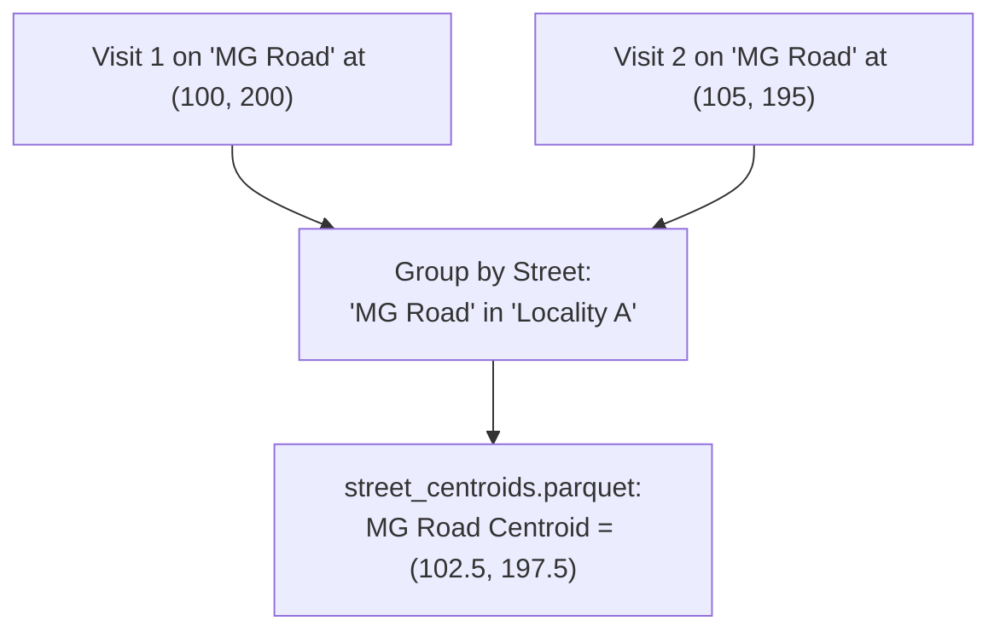
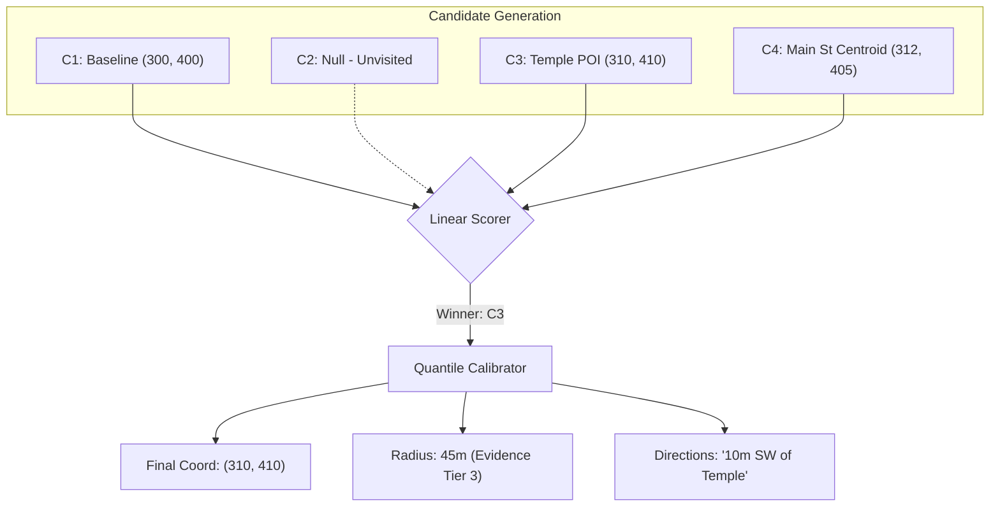
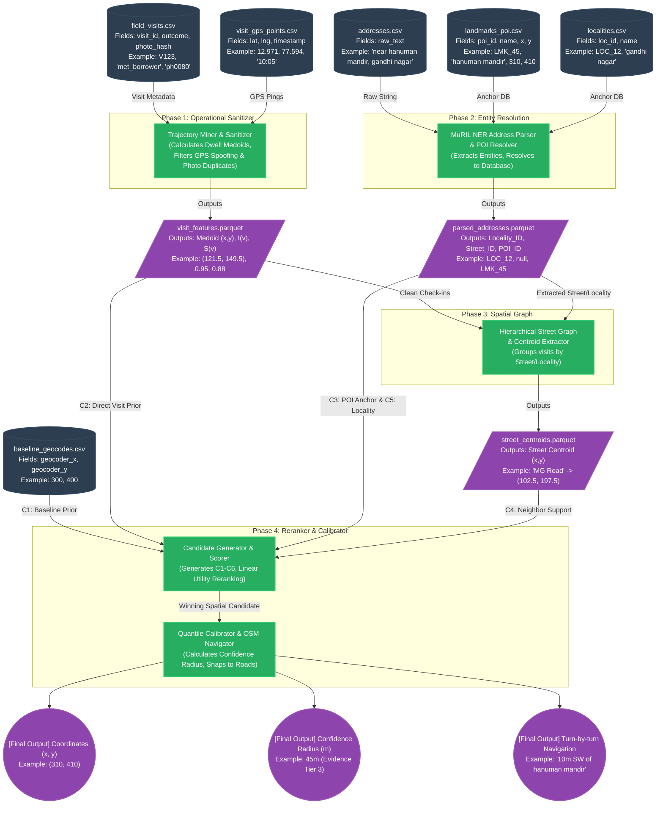

# NeuroGeo-Field: Comprehensive Architecture & Data Flow

This document provides a deep, detailed explanation of the NeuroGeo-Field Spatial Inference Engine, visualizing how data flows through the system, how values are transformed, and the sources of each data point.

## High-Level Architecture Overview

The system rejects continuous coordinate regression and instead uses a **Retrieve → Rank → Calibrate** paradigm:
1. **Retrieve** evidence from historical visits, raw text, and spatial anchors to form discrete hypotheses (Candidates C1-C6).
2. **Rank** these spatial candidates using a deterministic linear scorer based on semantic alignment and neighbor support.
3. **Calibrate** an empirical confidence radius and generate turn-by-turn directions.

---

## 1. System Master Flow Diagram

---

## 2. Deep Dive: Phase-by-Phase Breakdown with Examples

### Phase 1: Operational Sanitizer & Trajectory Miner
This block cleanses the operational field agent data to establish ground truth "Check-ins" (Direct Visit Doorstep Medoids) and assigns integrity weights.

- **Inputs**: 
  - `field_visits.csv`: Agent logs (e.g., visit_id, address_id, outcome, photo_hash).
  - `visit_gps_points.csv`: Raw GPS pings taken every ~30 seconds during a visit.
- **Process**:
  - **Collision Detection**: Discards visits if an agent reused the exact same photograph (`photo_hash`) across multiple visits (Spoofing).
  - **Dwell/Speed Weighting**: Calculates tortuosity and dwell medoids to assign an Integrity Score $I(v)$ and Spatial Evidence Strength $S(v)$.
- **Output**: `visit_features.parquet` (Cleaned medoid coordinates and reliability weights for each visit).

---

### Phase 2: Multilingual Address Parser & POI Resolver
This block uses Deep Learning (MuRIL Transformer NER) to understand messy, multi-lingual Indian addresses and map them to physical anchor databases.

- **Inputs**: 
  - `addresses.csv`: e.g., "near hanuman mandir, behind ration shop, gandhi nagar 560001"
  - `landmarks_poi.csv` & `localities.csv`: Known mapping datasets.
- **Process**: 
  - MuRIL extracts entities (Street, Landmark, Locality). 
  - The POI Resolver canonicalizes these entities (e.g., mapping "hanuman mandir" to a specific `poi_id` bounded within "gandhi nagar").
- **Output**: `parsed_addresses.parquet`

---

### Phase 3: Spatial Graph & Cold-Start Propagation
Builds a hierarchical relationship graph (`Town -> Locality -> Street`) to allow unvisited "cold-start" addresses to borrow location knowledge from visited neighbors on the same street.

- **Inputs**: `parsed_addresses.parquet` and `visit_features.parquet`.
- **Process**: Groups all high-integrity visits (`I(v) > 0.85`) by their extracted Street and Locality tokens to compute robust `street_centroids`.
- **Output**: `street_centroids.parquet`

---

### Phase 4: Candidate Reranker & Quantile Calibrator
The core decision engine. It generates 6 potential coordinates (Candidates), ranks them, and assigns mathematical uncertainty.

#### The 6 Spatial Candidates:
1. **C1 (Commercial Baseline Prior)**: Sourced from `baseline_geocodes.csv` (e.g., Google Maps pin).
2. **C2 (Direct Visit Doorstep Medoid)**: Sourced from Phase 1 if the address was historically visited.
3. **C3 (POI Anchor Coordinate)**: Sourced from Phase 2 if a landmark was extracted.
4. **C4 (Neighbor Street Cluster)**: Sourced from Phase 3 street centroids.
5. **C5 (Locality Centroid)**: Safe fallback to the neighborhood center.
6. **C6 (Bayesian Grid Fallback)**: Machine Learning fallback for "Graph Deserts" where streets aren't matched.

- **Ranking Process**: A deterministic linear scorer evaluates semantic alignment and neighbor support to pick the best Candidate.
- **Calibration Process**: Based on the chosen Candidate tier, it assigns a dynamic Confidence Radius ($R$) using empirical quantiles (e.g., if C2 is chosen, R is small; if C5 is chosen, R is large).
- **Outputs**: Final $(x,y)$, Radius, and offline Directions (snapped to OSM).

---

## 3. Data In/Out Example (End-to-End)

**Scenario**: A new loan applicant (Cold-Start / Unvisited).
**Input Record**:
- `address_id`: `ACC_999`
- `address_text`: *"Flat 2B, opposite Apollo Pharmacy, 2nd Cross, HSR Layout"*
- `baseline_geocode`: `(x: 1500, y: 2500)` (Google Maps guessed a generic HSR Layout center).

**Flow Execution**:
1. **Phase 1**: Skips (No historical visits).
2. **Phase 2 (Parser)**: 
   - *Leaves block as*: `landmark='Apollo Pharmacy'`, `street='2nd Cross'`, `locality='HSR Layout'`.
   - `poi_id` resolved to `(x: 1800, y: 2850)`.
3. **Phase 3 (Spatial Graph)**:
   - *Leaves block as*: Finds previous visits by other people on '2nd Cross' in 'HSR Layout' resulting in street centroid `(x: 1810, y: 2840)`.
4. **Phase 4 (Reranker)**:
   - Evaluates:
     - C1: `(1500, 2500)`
     - C3: `(1800, 2850)` [Apollo]
     - C4: `(1810, 2840)` [2nd Cross]
   - *Leaves block as*: Chooses **C4** as the winner due to strong neighbor support on the street network.
5. **Phase 4 (Calibrator/OSM)**:
   - *Leaves block as Final Output*: 
     - Coordinates: `(1810, 2840)`
     - Radius: `35m` (Tight confidence because street matches).
     - Directions: *"14m South of Apollo Pharmacy on 2nd Cross"*.

---

## 4. Complete System Component Graph

