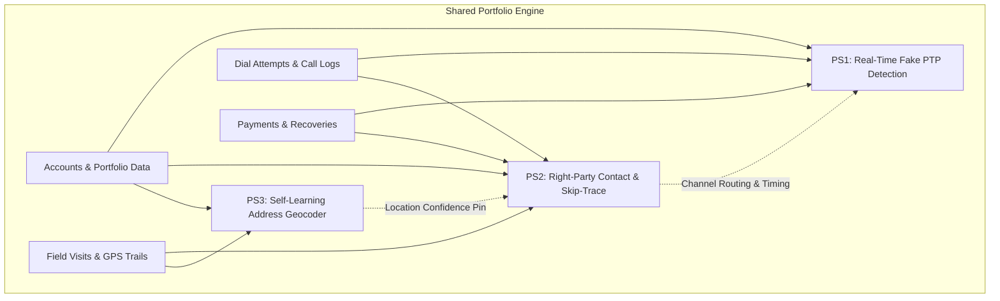
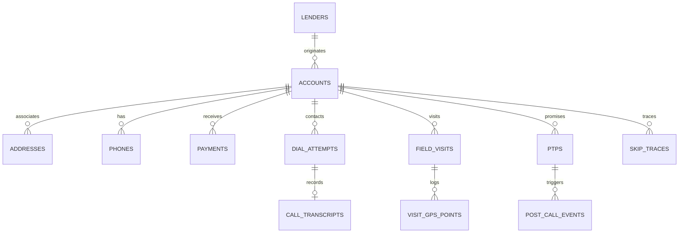

# CreditNirvana (OpenIIT '26) Problem Statements & Data Intelligence Report

---

## Executive Summary

CreditNirvana (CN) operates an AI-native debt collections and recovery platform across India's banking, NBFC, ARC, and fintech sectors. The challenge spans **three distinct problem statements** set against a realistic, multi-layered synthetic dataset mirroring real-world debt recovery dynamics:

1. **PS1 — Real-Time Fake PTP (Promise-to-Pay) Detection**: Sub-second in-call NLP/speech classifier and agent prompting engine to identify insincere, unfeasible, or agent-pushed promises during live calls.
2. **PS2 — Right-Party Contact (RPC) Prediction & Skip-Trace Prioritization**: Dynamic survival/state modeling of phone and address contact points, separating borrower avoidance from dead contacts, and optimizing skip-trace spend via Value-of-Information (VOI).
3. **PS3 — Address Geocoder That Learns from Field Visits**: Multilingual spatial intelligence engine converting unstructured, landmark-dependent Indian addresses into calibrated GPS pins and navigation cues by mining noisy field visit traces and filtering agent fraud.

---

## Part 1: Deep-Dive Analysis of the 3 Problem Statements



### Shared Context & Structural Constraints

Every problem statement is governed by three foundational industry realities:
- **Regulatory Guardrails**: RBI Fair Practices Code (FPC) dictates calling hours, contact frequency, harassment prohibitions, and strict third-party non-disclosure. DPDP Act mandates strict purpose limitation, consent, and auditable explainability.
- **Counterfactual Bias & Selection Effects**: Historical data is observational and reflects the incumbent rule-based policy. A dial attempt was only recorded if the system chose to call; an address was only visited if scheduled. Naive supervised models will simply learn and entrench historical operational biases.
- **Steep Cost Asymmetry Across Channel Stack**:
  - SMS / WhatsApp: < ₹0.20 per touch
  - AI Voice Bot: ₹1 – ₹3 per completed call
  - Human Tele-calling: ₹15 – ₹30 per connected call
  - Physical Field Visit: ₹150 – ₹400 per productive visit
  - Skip-Tracing: ~₹60 – ₹150 per search

---

### Comparative Analysis Table: PS1 vs PS2 vs PS3

| Dimension | PS1: Real-Time Fake PTP Detection | PS2: Right-Party Contact & Skip-Trace | PS3: Self-Learning Address Geocoder |
| :--- | :--- | :--- | :--- |
| **Domain Archetype** | Real-time Streaming NLP, Speech Analytics & Dialogue Policy | Dynamic Graph / Survival Modeling & Decision Theory (VOI) | Geospatial AI, Multilingual NER, Entity Resolution & Trajectory Mining |
| **Primary Decision** | During-call: What prompt/action to nudge the borrower with? Post-call: How long to park the account? | Pre-call / Pre-visit: Which contact point to try, which channel to use, and when to spend money on skip-tracing? | Pre-visit & Routing: Where exactly is the address, what is the uncertainty radius, and how does the agent reach it? |
| **Data Modality** | Code-mixed conversational text, acoustic pauses/timings, disposition streams, post-call events | Multi-channel event logs, call network responses, phone-account linkage graphs, cost/outcome logs | Unstructured multilingual text (Kannada/Hindi/English), GPS trajectories, dwell times, POI database |
| **Key Complexity** | Sub-second latency, partial transcript evaluation, subtle distinction between hardship vs evasion | Distinguishing "avoiding" from "invalid", handling silent number recycling, censoring bias | Extracting relative spatial relationships, clustering multi-spelling landmarks, filtering fraudulent visits |
| **Business Metric** | Incremental recovery via randomized prompt trials, reduced parking dead-time | RPC rate per 1,000 touches, reduction in dead-contact touches, net recovery minus skip-trace cost | Median & 90th percentile location error (m), reduction in "address not traceable" rate |

---

### Detailed Breakdown: Problem Statement 1 (Real-Time Fake PTP Detection)

#### 1. The Problem
A Promise to Pay (PTP) is the primary positive outcome logged during debt collection calls, yet **over 61.7% of PTPs break** (only 38.3% see any payment within the window, and only 27.8% pay the full promised amount). When a PTP is logged, the account is "parked" (no collection actions taken until the promised date). Broken PTPs waste valuable days, re-enter collections at higher delinquency stages requiring more expensive channels, and create phantom recovery metrics that mask portfolio decay.

PTPs break for fundamentally distinct behavioral reasons:
- **Genuine & Feasible**: Borrower has cashflow and intent (keep rate ~72%).
- **Genuine but Infeasible**: Borrower has intent but cashflow mismatch (keep rate ~39%, full keep rate ~14%).
- **Escape Promise**: Borrower agrees just to get the agent off the phone (keep rate ~11%, full keep rate ~5.7%).
- **Repeat Promiser**: Habitual default pattern with chronic broken promises (keep rate <3.5%).
- **Third-Party Promise**: Family member makes an unconfirmed commitment (keep rate ~33%).
- **Agent-Recorded / Pushed**: Agent fabricates or coerces a PTP to meet shift targets (keep rate ~23%).

#### 2. Objective to Achieve
1. **In-Call Real-Time Scorer**: Predict the probability of payment ($P(\text{Kept})$) and the PTP taxonomy class within hundreds of milliseconds as transcripts stream in.
2. **Dynamic In-Call Nudge Engine**: Generate contextual prompts while the borrower is on the line (e.g., asking for an immediate token payment of ₹1,000–₹2,000 via UPI link, realigning the date to match the salary credit day).
3. **Adaptive Post-Call Disposition Engine**: Replace one-size-fits-all account parking with credibility-based parking windows, automated WhatsApp/SMS verification, and integrity auditing.

#### 3. Methods & Technical Architecture
- **Real-Time Streaming NLP**: Lightweight transformer encoders (e.g., MiniLM, IndicBERT, or fine-tuned DistilBERT) with causal attention masks to score partial turn sequences incrementally.
- **Acoustic & Conversational Dynamics Extraction**: Quantify speech pauses (`pause_before_ms`), response latency, speaker turn ratios, hedging phrases ("dekhta hoon", "try karunga"), conditional clauses ("agar payment aaya"), and agent pressure markers.
- **Multi-Task Classification**: Shared feature backbone with twin heads: (a) binary keep probability calibrated via isotonic regression, and (b) 6-class PTP taxonomy classifier.
- **Agent Integrity Scoring**: Anomaly detection model comparing agent-specific keep rates against cohort benchmarks, identifying end-of-shift PTP surges and verbatim remark duplication.

#### 4. Data Usage
- `data/ps1_fake_ptp/call_transcripts.csv`: Turn-by-turn text, timestamps, pauses, and ASR confidence.
- `data/ps1_fake_ptp/ptps.csv`: Promised amount, overdue balance, promised date, recording channel.
- `data/ps1_fake_ptp/post_call_events.csv`: Downstream signals (WhatsApp delivery/replies, payment link clicks).
- `data/ps1_fake_ptp/annotated_ptp_sample.csv`: 200 labeled PTPs (used with label-noise mitigation techniques).
- `data/shared/accounts.csv`: Financial context (income type, salary credit day, ability to pay, past PTP history).
- `data/shared/dial_attempts.csv` & `payments.csv`: Ground-truth payment realization matching.

#### 5. Evaluation Criteria
- **Model Quality**: ROC-AUC, PR-AUC, and Brier calibration score on test set PTPs.
- **Fairness & Compliance Metric**: Hardship misclassification rate (false positives where genuine hardship is labeled as an escape promise).
- **Business Impact**: Simulated/RCT recovery lift and days of parking dead-time saved.

#### 6. Expected Deliverables
- In-call inference pipeline supporting streaming partial transcripts.
- Multi-task model weights and classification evaluation scripts.
- Rule/Prompt generation engine with explainability payload (SHAP/feature contributions).
- Agent gaming detection dashboard / script.

---

### Detailed Breakdown: Problem Statement 2 (Right-Party Contact & Skip-Trace Prioritization)

#### 1. The Problem
Collections teams blindly execute calling campaigns and field visits against outdated contact lists. Dial attempts hit dead numbers, recycled numbers, or evasive borrowers. Currently:
- **Skip-tracing is triggered by a blunt, static rule**: Accounts are sent to skip-trace only after **15 consecutive failed attempts**, regardless of debt size or contact evidence.
- **Massive capital waste**: In the provided data, **77.1% of skip-traces yield zero new information** (`no_new_info`), burning ₹104 on average per trace.
- **Regulatory hazard**: Reaching a recycled number risks disclosing debt details to an unrelated third party, directly violating RBI and DPDP regulations.

#### 2. Objective to Achieve
1. **Contact Point Health & RPC Model**: Predict the probability of achieving a Right-Party Contact ($P(\text{RPC})$) for every phone number and physical address.
2. **Behavioral State Separator**: Distinguish between *Borrower Avoiding* (valid number, active phone, intentional ignore $\rightarrow$ switch channel to WhatsApp/Field) versus *Contact Invalid/Dead* (switched off long-term, out of service $\rightarrow$ cease calling, consider trace).
3. **Value-of-Information (VOI) Skip-Trace Optimizer**: Formulate skip-trace triggering as an economic decision:
   $$\mathbb{E}[\text{Net Value of Trace}] = P(\text{Valid Contact Found}) \times P(\text{Recovery} \mid \text{Reached}) \times \text{Balance} - \text{Trace Cost}$$
   Only trace when $\mathbb{E}[\text{Net Value}] > 0$, replacing fixed attempt counters.

#### 3. Methods & Technical Architecture
- **Survival Analysis / Hidden Markov Models (HMM)**: Model the latent state of each contact point (Active, Evasive, Dormant, Dead, Recycled) over time. As time elapses without an RPC, contact decay curves adjust dynamically.
- **Bipartite Entity Graph Analysis**: Graph neural networks or entity resolution algorithms linking phones/addresses across borrowers to detect co-borrower references, shared family phones, or telecom recycling clusters.
- **Contextual Bandits / Counterfactual Learning**: Utilize the provided `random_contact_point` dialling arm (123 accounts) using Inverse Propensity Scoring (IPS) to de-bias the model from historical rule-based tele-caller behaviors.
- **VOI Decision Engine**: Constrained optimization ranking accounts by expected marginal recovery net of skip-trace and contact costs.

#### 4. Data Usage
- `data/ps2_right_party_contact/phones.csv`: Phone metadata, priority slots, origination sources.
- `data/ps2_right_party_contact/skip_traces.csv`: Historical trace outcomes, triggers, and costs.
- `data/ps2_right_party_contact/verified_contact_points.csv`: 250 ground-truth audited phone numbers.
- `data/shared/dial_attempts.csv`: 51,105 telephony attempts with network responses (`ring_no_answer`, `switched_off`, `not_reachable`), dispositions, and agent remarks.
- `data/shared/field_visits.csv`: Cross-channel contact evidence (locked premises vs shifted).

#### 5. Evaluation Criteria
- **Model Accuracy**: AUC and calibration of $P(\text{RPC})$ per contact attempt.
- **Operational Efficiency**: Reduction in wasted touches on dead contacts before action.
- **Economic Lift**: Skip-trace hit rate and net recovery compared against the 15-attempt baseline rule.
- **Compliance**: Zero third-party disclosure incidents on recycled numbers.

#### 6. Expected Deliverables
- Contact point survival/health scoring service.
- Dynamic channel routing engine (Dialer priority list + WhatsApp/Field switch rules).
- Cost-optimal skip-trace recommendation pipeline with ranked priority queue.
- Counterfactual evaluation report showing de-biased policy gains.

---

### Detailed Breakdown: Problem Statement 3 (Address Geocoder That Learns from Field Visits)

#### 1. The Problem
Field collection efficiency in India is severely degraded by unstructured, descriptive addresses (e.g., *"behind PDS Shop, near Hanuman Temple, 6th Cross, Kaveripura"*).
- **Commercial Geocoder Failure**: Commercial APIs default to pincode or locality centroids, resulting in a **median error of 376.4 meters** and **90th percentile error exceeding 839 meters** (reaching 3.8+ km for pincode precision).
- **Excessive Agent Search Time**: Over **25.1% of field visits end in `address_not_traceable`**, forcing agents to waste hours asking neighbors or falsely abandoning valid accounts.
- **Untapped Operational Data**: Field visit logs already record GPS check-in locations, GPS trails, and dwell times, but this feedback loop has never been systematically fed back into address resolution.

#### 2. Objective to Achieve
1. **Self-Correcting Geocoding Engine**: Predict a high-accuracy coordinate pair $(x, y)$, a calibrated confidence radius $R$, and landmark-relative navigation cues for any input address.
2. **Visit Evidence Fusion**: Ingest historical field visit check-ins, trajectory shapes, and dwell times to update and pin down locations over time.
3. **Agent Fraud & Anomaly Filter**: Identify and discount fake field visits (e.g., check-ins from tea stalls or duplicate photos) to prevent polluting the spatial database.

#### 3. Methods & Technical Architecture
- **Multilingual Address NER & Parsing**: Extract structured components (House/Flat No, Road/Cross, Locality, Sub-locality, Pincode, and Relative Landmarks like *"behind"*, *"opp"*, *"bagal mein"*, *"hatthira"* across Kannada, Hindi, and English scripts).
- **Fuzzy Landmark & POI Resolution**: Spatial matching of extracted landmarks against the known `landmarks_poi.csv` database, resolving transliteration variants and misspellings (e.g., "Ganesh Mandir" vs "Ganesha Temple").
- **Probabilistic Spatial Aggregation (Bayesian Fusion / Kalman / Mean-Shift)**: Combine baseline geocodes with historical visit check-ins weighted by visit outcome (`met_borrower` has high weight, `locked_premises` has moderate weight, `address_not_traceable` provides negative evidence).
- **Agent Integrity Scoring**: Trajectory dwell-time analysis, check-in velocity, and photo-hash collision detection to eliminate fraudulent visits.

#### 4. Data Usage
- `data/shared/addresses.csv`: Raw, unstandardized address strings across 3 towns.
- `data/ps3_geocoder/baseline_geocodes.csv`: Commercial geocoder coordinates and precision levels.
- `data/ps3_geocoder/landmarks_poi.csv` & `localities.csv` & `towns.csv`: Geographic gazetteer.
- `data/shared/field_visits.csv` & `data/ps3_geocoder/visit_gps_points.csv`: 5,578 visits and 160,406 GPS trail points.
- `data/ps3_geocoder/surveyed_addresses.csv`: 100 high-precision ground truth surveyed locations.

#### 5. Evaluation Criteria
- **Distance Accuracy**: Median and 90th-percentile Euclidean distance error against the 100 surveyed addresses, benchmarked against the commercial baseline.
- **Operational Reduction**: Decrease in simulated "address not traceable" visit outcomes.
- **Radius Calibration**: Fraction of ground-truth points falling within the predicted confidence radius $R$.

#### 6. Expected Deliverables
- End-to-end address parsing and geocoding pipeline.
- Bayesian evidence updater that ingests visit GPS trails.
- Offline navigation aid module generating human-readable landmark directions.
- Error reduction benchmark report vs baseline geocoder.

---

### Comparative Evaluation & Problem Statement Selection Guidance

```mermaid
quadrantChart
    title Feasibility vs Competition Winning Potential
    x-axis Low Technical Moat --> High Technical Moat
    y-axis Low Data Readiness --> High Data Readiness
    quadrant-1 Sweet Spot: Highest Win Potential
    quadrant-2 High Readiness, Lower Moat
    quadrant-3 High Risk, Low Readiness
    quadrant-4 Technically Complex, High Upside
    "PS1: Fake PTP Detection": [0.88, 0.92]
    "PS2: RPC & Skip-Trace": [0.72, 0.85]
    "PS3: Field Geocoder": [0.78, 0.70]
```

#### Feasibility & Impact Scorecard

| Criterion (Weight) | PS1: Fake PTP Detection | PS2: RPC & Skip-Trace | PS3: Field Geocoder |
| :--- | :---: | :---: | :---: |
| **Data Completeness & Richness** (25%) | **9.5/10** (Transcripts, ASR, PTPs, post-call events, payments) | **8.5/10** (51k calls, network responses, phone graphs, verified sample) | **7.5/10** (Text, 160k GPS points, 100 ground truth benchmarks) |
| **Methodological Innovation / Moat** (25%) | **9.0/10** (Streaming NLP, code-mixed acoustics, gaming detection, nudges) | **8.5/10** (Survival curves, bandits, VOI optimization) | **8.0/10** (Multilingual NER, spatial graph clustering, trajectory mining) |
| **Clear Ground-Truth Linkage** (20%) | **9.0/10** (Direct objective payment outcomes + annotated taxonomy) | **8.0/10** (Partially latent states; verified set of 250 phones) | **8.5/10** (100 surveyed ground truth coordinates) |
| **Business Value & Wow Factor** (20%) | **9.5/10** (Direct revenue recovery, in-call live agent assist) | **8.5/10** (Cost savings on dialer and skip-trace) | **8.0/10** (Field route efficiency, navigation directions) |
| **Implementation Tractability (Hackathon)** (10%) | **9.0/10** (Direct PyTorch/HuggingFace/XGBoost pipelines) | **8.5/10** (Survival + Bandit framing requires careful setup) | **7.5/10** (Coordinate geometry + multilingual text parsing) |
| **Overall Score** | **9.1 / 10** ⭐ (Top Pick) | **8.4 / 10** | **7.9 / 10** |

> **Recommendation**: **Problem Statement 1 (Real-Time Fake PTP Detection)** offers the most complete, dynamic, and high-impact storyline for OpenIIT. It combines cutting-edge code-mixed conversational NLP, acoustic feature engineering, agent fraud auditing, and real-time operational nudging with indisputable financial impact.

---

## Part 2: Comprehensive Data Intelligence & EDA Report

### 1. Data Ecosystem Topology & Volume Overview



The dataset comprises **19 CSV files** structured into a shared foundation and three problem-specific pods:
- **Accounts**: 2,400 loan accounts across 6 diverse lenders (L01–L06: Private Banks, NBFCs, Fintechs, MFIs).
- **Splits**: Exactly stratified into **1,680 Train (70%)**, **360 Validation (15%)**, and **360 Test (15%)**.
- **Telephony & Visits**: 51,105 dial attempts, 3,367 calls with turn-by-turn transcripts (39,194 turns), 5,578 field visits, and 160,406 visit GPS points.
- **Recoveries**: 2,162 actual payment transactions totaling ₹27.37M across 1,667 unique accounts.

---

### 2. Deep-Dive Pattern Discoveries

#### Pattern 1: PTP Keep Rates and the "Taxonomy Divergence"
Matching all 3,696 PTPs against actual ledger payments in `payments.csv` reveals:
- **Baseline Keep Rate**: Only **38.3%** of PTPs receive any payment within the promised date (+3-day grace period), and only **27.8%** pay the full promised amount.
- **Taxonomy Validation**: When evaluating the 200 human-annotated PTPs against actual payment realization, the behavioral divergence across types is stark:

| PTP Taxonomy Class | Sample Count | Actual Keep Rate (Any Payment) | Full Amount Keep Rate |
| :--- | :---: | :---: | :---: |
| **Genuine & Feasible** | 54 | **72.2%** | **61.1%** |
| **Genuine Infeasible** | 51 | **39.2%** | **13.7%** |
| **Third-Party Promise** | 18 | **33.3%** | **27.8%** |
| **Agent Recorded / Pushed** | 13 | **23.1%** | **15.4%** |
| **Escape Promise** | 35 | **11.4%** | **5.7%** |
| **Repeat Promiser** | 29 | **3.4%** | **0.0%** |

*Insight*: The difference between *Genuine Infeasible* and *Escape* is critical. Infeasible borrowers frequently attempt partial payments (39% pay something, but only 13% pay in full). Escape promisers almost never pay anything (11% pay, 5.7% pay full). This proves the necessity of multi-class classification rather than simple binary prediction.

#### Pattern 2: Multi-Account Phone Sharing & Network Graph
Out of 5,719 phone numbers across 2,400 accounts:
- **1,106 masked phone numbers appear across multiple borrower accounts**.
- Analysis of phone sources confirms that while `kyc_origination` numbers have an answered rate of 22.8%, `reference` numbers have an answered rate of **43.7%**! However, calling a reference number results in `third_party_contact` 85%+ of the time.
- In `verified_contact_points.csv` (250 audited phones), 74 are third-party numbers and 27 are `not_borrower_number` (recycled numbers). Recycled numbers show an average of 1.06 `wrong_number` dispositions per phone.

#### Pattern 3: Baseline Geocoder Failure vs Ground Truth
Evaluating the commercial geocoder (`baseline_geocodes.csv`) against the 100 ground truth `surveyed_addresses.csv`:
- **Median Distance Error**: **376.4 meters**.
- **90th Percentile Distance Error**: **839.2 meters**.
- **Maximum Distance Error**: **4,807.7 meters (4.8 km!)**.
- **Breakdown by Geocoder Precision Level**:
  - `locality` level (73% of sample): Median error = 385.9m, 90th percentile = 626.5m.
  - `pincode` level (10% of sample): Median error = **1,375.8m**, 90th percentile = **3,820.1m**.
  - `street` level (16% of sample): Median error = 108.6m.
  - `rooftop` level (1% of sample): Median error = 25.6m.

#### Pattern 4: Spatial Validity of Field Visit Outcomes
By mapping field visit check-in coordinates against the 100 surveyed ground truth coordinates:
- When agents record `met_borrower`, their check-in is remarkably close to ground truth: **Median error = 34.3 meters**.
- When agents record `met_family`, median error is **15.9 meters**.
- When agents record `locked_premises`, median error is **20.2 meters** (proving the agent found the exact right house, even if the borrower was absent!).
- When agents record `address_not_traceable`, the median check-in distance is **1,603.2 meters** (agents are searching in entirely the wrong neighborhood).

---

### 3. Critical Anomalies & Planted Signals

Our forensic data audit uncovered **five critical planted anomalies** that directly affect solution design:

#### Anomaly 1: Fraudulent Field Agent Activity (Duplicate Photo Hashes)
- In `field_visits.csv`, while most photo hashes are unique, **172 visits share identical photo hashes across multiple unrelated accounts**.
- **Field Agent FA009 is responsible for 162 of these duplicate photo visits** (`ph0080`–`ph0084` reused up to 32 times each!).
- Furthermore, FA009 has an abnormally low average dwell time (149 seconds vs team average of 345s).
- *Solution Impact*: Any spatial geocoding model that blindly trusts FA009's check-in coordinates will be poisoned by fraudulent check-ins from the agent's residence or tea stall. **An agent integrity filter must be applied before spatial aggregation.**

#### Anomaly 2: Tele-Caller PTP Gaming (End-of-Shift Quota Stuffing)
- In `dial_attempts.csv` and `ptps.csv`, tele-caller **TA013 exhibits severe end-of-shift PTP bunching**: 26 PTPs logged between 17:00 and 18:59 (hours 17 and 18).
- Concurrently, **TA013 has one of the worst PTP keep rates across the entire tele-calling floor: 25.7%** (compared to high-integrity agents like TA009 at 49.7% and BOT01 at 46.4%).
- *Solution Impact*: Models trained on agent-logged PTPs must include agent-level historical credibility features and temporal shift-hour indicators to penalize rushed end-of-day promises.

#### Anomaly 3: Extreme Waste in Static Skip-Tracing Rules
- In `skip_traces.csv`, **100% of the 766 skip-traces were triggered by a single naive rule**: `15_consecutive_failed_contacts`.
- This rigid rule resulted in a **77.1% failure rate** (591 traces produced `no_new_info`).
- At an average cost of ₹104 per trace, **₹61,464 out of ₹79,650 spent was completely wasted**.
- *Solution Impact*: Massive opportunity for PS2. A dynamic VOI model will demonstrate immediate, quantifiable cost savings by cutting low-probability traces and tracing high-balance accounts earlier.

#### Anomaly 4: Noisy Human Labels in PS1 Annotated Sample
- `data/ps1_fake_ptp/annotated_ptp_sample.csv` contains 200 labeled PTPs, but the README warns that *"some labels are wrong"*.
- Our inspection revealed that **95 out of 200 annotations (47.5%) are tagged as `medium` or `low` confidence** by the human reviewer!
- *Solution Impact*: Do not treat `annotated_ptp_sample.csv` as flawless ground truth. Implement label-smoothing, confident learning (e.g., Cleanlab-style noise estimation), or semi-supervised consistency regularization against downstream payment outcomes.

#### Anomaly 5: Multilingual Code-Mixing & Transliteration in Addresses and Transcripts
- Addresses in Town T1 (Kaveripura) blend Kannada script (e.g., *"ಚರ್ಚ್ ಹತ್ತಿರ"*) with English numbers (*"6th Cross, 5th Main"*).
- Addresses in Town T2 (Devgarh Nagar) blend Devanagari script (e.g., *"गली नं. 3, राशन की दुकान के बगल में"*) with Hindi transliterations (*"ke bagal mein"*).
- Transcripts feature Kanglish and Hinglish dialogue (*"business tumba down ide"*, *"Nodtini. Party payment kottre naadiddu olage maadtini"*).
- *Solution Impact*: Standard ASCII tokenizers and English-only NLP models will fail completely. Multilingual embeddings (mBERT, IndicBERT, XLM-R) and rule-based transliteration mapping (Indic-to-Latin) are mandatory.

---

### 4. Architectural Guardrails for the Solution

1. **De-biasing via the Random Arm**: Both PS1 and PS2 must exploit the `random_contact_point` dialling arm in `accounts.csv` (123 accounts) to evaluate and calibrate models free from the operational selection bias of tele-callers.
2. **Multi-Stage Data Cleaning**:
   - Filter out duplicate photo visits (especially agent FA009).
   - Filter out short-dwell visits (<60 seconds, which are almost entirely `address_not_traceable` drive-bys).
3. **Calibrated Confidence Radii**: For PS3, distance error follows a heavy-tailed log-normal distribution. The predicted confidence radius $R$ must be calibrated against empirical percentiles rather than Gaussian standard errors.
4. **Explainability & Compliance Logging**: All models must output human-interpretable reason codes (e.g., "PTP unfeasible: salary credit is 5th, promised date is 2nd") to fulfill RBI Fair Practices Code and DPDP requirements.

---

## Conclusion & Recommended Action Plan

The provided datasets are exceptionally well-engineered, with embedded real-world nuances (gaming, fraud, selection bias, label noise, and multilingual noise). 

| Phase | Core Milestone | Deliverable |
| :--- | :--- | :--- |
| **Phase 1: Decision** | Finalize choice between PS1, PS2, or PS3 | Team consensus (Recommended: **PS1**) |
| **Phase 2: Baseline** | Build end-to-end pipeline on clean features | Baseline pipeline & cross-validation setup |
| **Phase 3: Core Innovation**| Address the domain anomalies (gaming, noise, code-mixing) | Advanced models + calibration layer |
| **Phase 4: Productization** | Package into an auditable, explainable API & UI | Interactive demo dashboard + evaluation deck |
